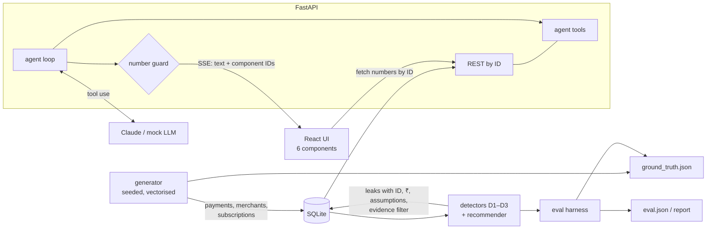

# Leak Radar

**An AI cross-sell copilot for payment-gateway account managers.** An AM asks a question in chat; the agent
finds where a merchant is losing money on failed payments, sizes it in ₹, shows the evidence, recommends the
product that fixes it, and drafts outreach the AM must approve.

> **Synthetic demo data.** Every merchant, payment, bank (`BANK_A`…`BANK_H`) and error code is generated.
> *Independent concept project. Not affiliated with or endorsed by Razorpay. Product names are used only to
> illustrate fit.* Product names in `config/products.yaml` are marked `verified: false` — verify them on the
> public site before any demo.

## The problem

An AM covering ~150 SMB / mid-market merchants can't analyse each merchant's transactions. Three
leaks are common and fixable, and each maps to a product:

| Leak | What it looks like | Fix (illustrative) |
|---|---|---|
| **Bank/method failure spike** | One issuer bank × method fails 10–25 pts above the merchant's other banks, at certain hours or on sale days | Smart routing (*Optimizer*) |
| **UPI Collect instead of Intent** | 30–60% of UPI goes through collect requests customers never approve, mostly on mobile | Intent-first checkout |
| **Subscription silent churn** | Mandate renewals fail for system reasons (pre-debit notification, inactive mandate), not customer funds | Smart retries |

If the merchant already has the fitting product, the copilot says **"config review"** instead of pitching it again.

## How it works



**Numbers come from code, never from the LLM.** This is enforced in three places:

1. **Detectors** compute every ₹ figure, rate and count, and store each one with a `leak_id`, the exact
   assumptions used, and an `evidence_query` that reproduces the underlying rows.
2. **UI components get IDs, not numbers.** The agent can only call `render_component(type, props)` with one of
   six registered types. Props are IDs, validated by Pydantic and checked against the database; zod checks
   them again in the browser. Each component fetches its own figures from the REST API.
3. **The number guard** (`leakradar/agent/number_guard.py`) checks every assistant message before the AM
   sees it. Any figure that isn't in that turn's tool results triggers one rewrite; if the rewrite still has
   one, the figure is redacted. The guard understands `₹1.4L`, `₹1.38 lakh`, `1,40,000`, `₹2.1Cr`, `14.1%`,
   `9.3 pts`, `3.5x`. It matches by rounding plus a 5% relative cap, so "₹1L" can't stand in for ₹1.38L. It
   exempts small counts, dates, times and IDs.

Pitch drafts follow the same rule. The LLM writes wording with `{placeholders}`, any digit in the template
is rejected, and code fills in the figures from the leak record. **Approve only records a status; nothing
is ever sent.**

## Evaluation

The generator plants 30 leaks (10 per detector) plus 13 decoys: low-volume noisy merchants, merchants with
isolated bad days, and merchants with heavy `INSUFFICIENT_FUNDS` failures, which are customer-caused and must
not be flagged. Expected ₹ is computed from the **true planted probabilities** over the realised traffic, so
the ₹ error measures estimation error rather than echoing the detector's own formula back.

Targets per detector: precision ≥ 0.85, recall ≥ 0.85, median ₹ error ≤ 20%.

| Detector | Demo seed 42: P / R / ₹ err | 10 untouched test seeds: P / R (min) / ₹ err |
|---|---|---|
| Bank/method spike | 1.00 / 1.00 / 11.1% | 1.00 / 0.94 (0.80) / 11.4% |
| UPI Collect | 1.00 / 1.00 / 7.5% | 1.00 / 1.00 (1.00) / 8.2% |
| Subscription churn | 1.00 / 1.00 / 7.3% | 1.00 / 0.98 (0.90) / 5.9% |

**30/30 planted leaks found, 0 false positives on the demo dataset.** Full report: [docs/eval-report.md](docs/eval-report.md).

Gaps, stated honestly:
- D1 misses about 6% of plants on test seeds, mostly short sale-day spikes on mid-volume merchants. The
  planted cell sits near the 120-attempt gate, and after multiple-testing correction it can't be told apart
  from noise. That trade-off is deliberate: the same correction is what took D1 from false positives to zero.
- Thresholds were tuned while looking at seeds 42 and 1–5. The test seeds 101–110 were not used for tuning.
- Plants are synthetic and their shapes (hour windows on even hours, sale days) match what D1 scans for.
  Real leaks would be messier.

## Run it

Requires Python ≥ 3.11 and Node ≥ 18.

```bash
make setup
```

```bash
make demo
```

`make demo` runs generator → detectors → eval → web build, then serves everything at http://localhost:8000.
It defaults to the **offline mock LLM** (`LLM_PROVIDER=mock`), so no key or network is needed.

To use Claude, copy `.env.example` to `.env`, set `ANTHROPIC_API_KEY` and `LLM_PROVIDER=anthropic`
(default model `claude-sonnet-5-5`, overridable with `LLM_MODEL`; server-side refusal fallback on by default).

| Command | What it does |
|---|---|
| `make data SEED=42` | Generate ~700k payments + ground truth (≈5 s, deterministic per seed) |
| `make detect` | Run D1–D3 + recommender into the `leaks` table |
| `make eval` | Metrics vs ground truth + 10 held-out seeds → `docs/eval-report.md`, `data/eval.json` |
| `make test` | 74 backend tests + 15 frontend tests, mock LLM, no network |
| `make dev` | API on :8000 with reload + Vite on :5173 |
| `make live-check` | The demo script against the real model, 3 runs in a row (uses API credits) |

### Demo script

1. "Which of my merchants are losing the most this month?" → ranked `MerchantLeakTable`
2. Click the top row → `LeakCard` (with "how we calculated this"), `RootCauseCard`, `TrendChart`
3. "Draft a pitch, consultative tone" → `DraftMessage`; edit, approve
4. "Show me why" → `EvidenceDrawer` (raw rows plus the filter that reproduces them)
5. "Which merchants already have Optimizer but still leak?" → table of config-review leaks
6. The footer shows the eval summary

## Assumptions

Every threshold and sizing assumption lives in [`config/assumptions.yaml`](config/assumptions.yaml) and is
stored on each leak, so the UI's "how we calculated this" shows the exact values used. The main ones:
smart-routing recovery 50% of excess failures, net of what retries already recovered; 80% of mobile
collect traffic switchable to intent; smart-retry recovery 40% of system-failed renewals; 35% churn given a
failed renewal. These are illustrative and not benchmarked.

## Repo layout

```
config/            assumptions, product catalogue, synthetic error taxonomy, generator settings
leakradar/
  generator/       seeded vectorised data + planted leaks + ground truth
  detectors/       d1_bank_spike, d2_upi_collect, d3_subscription_churn, recommender, run
  eval/            matching, metrics, report
  agent/           tools, components (6 schemas), number_guard, pitch_templates, loop, llm (+ mock)
  api/             FastAPI: REST by ID + SSE chat; serves web/dist
  common/          db, repo (single data-access layer), evidence filter DSL, money formatting
web/               React + Vite + TS, Recharts; zod mirrors the component schemas
tests/             unit, api, e2e (demo script with mock; live variant), shared component fixtures
docs/              DECISIONS.md (design choices & deviations), eval-report.md
```

Design decisions and every deviation from the original spec are in [docs/DECISIONS.md](docs/DECISIONS.md).
